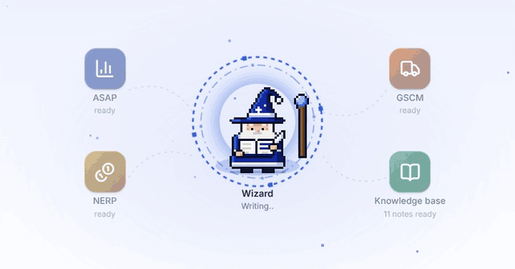
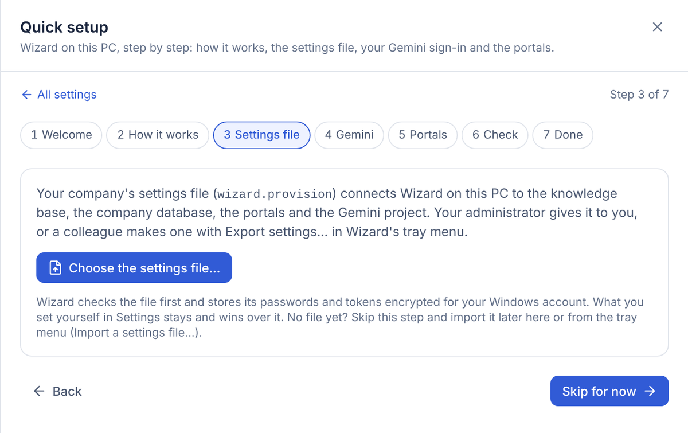
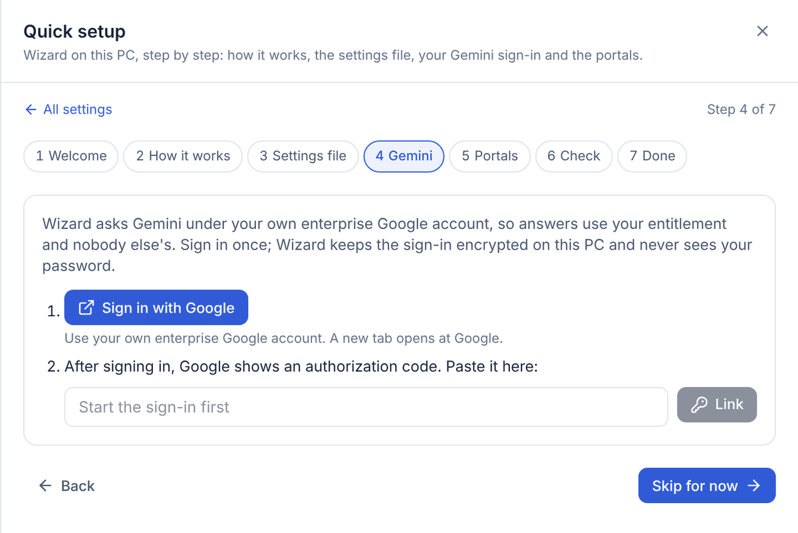
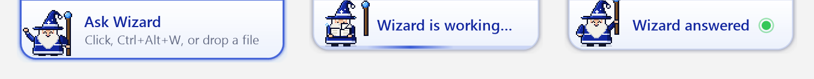
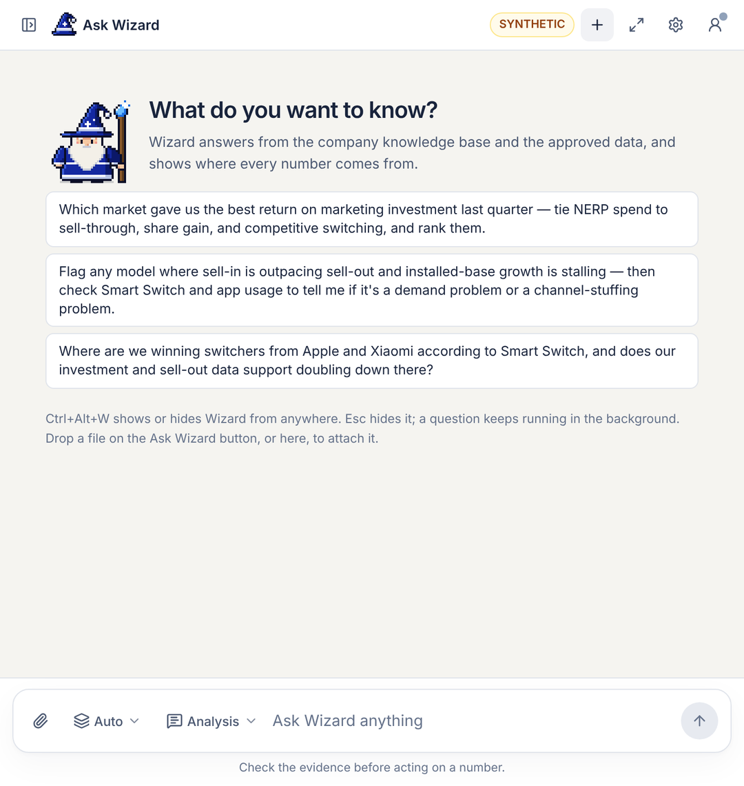
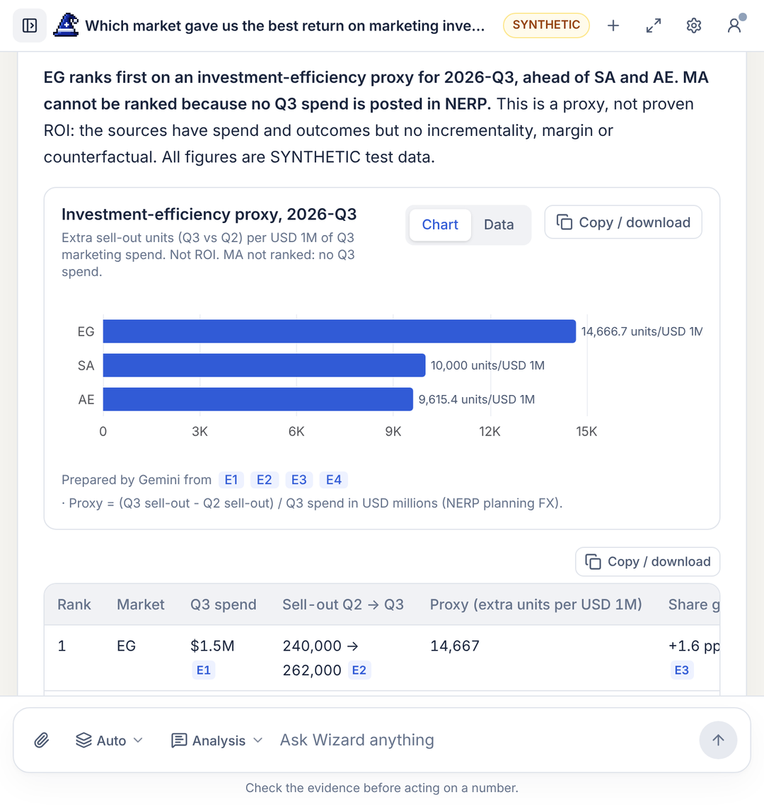
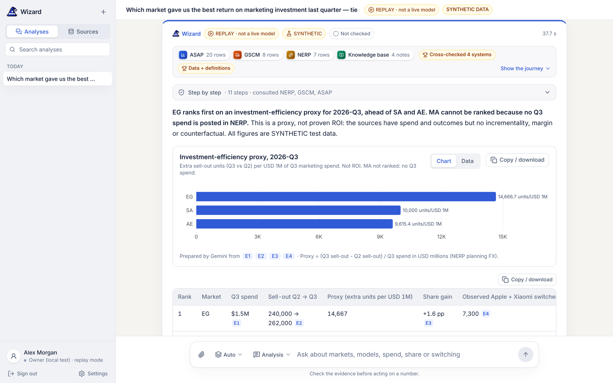
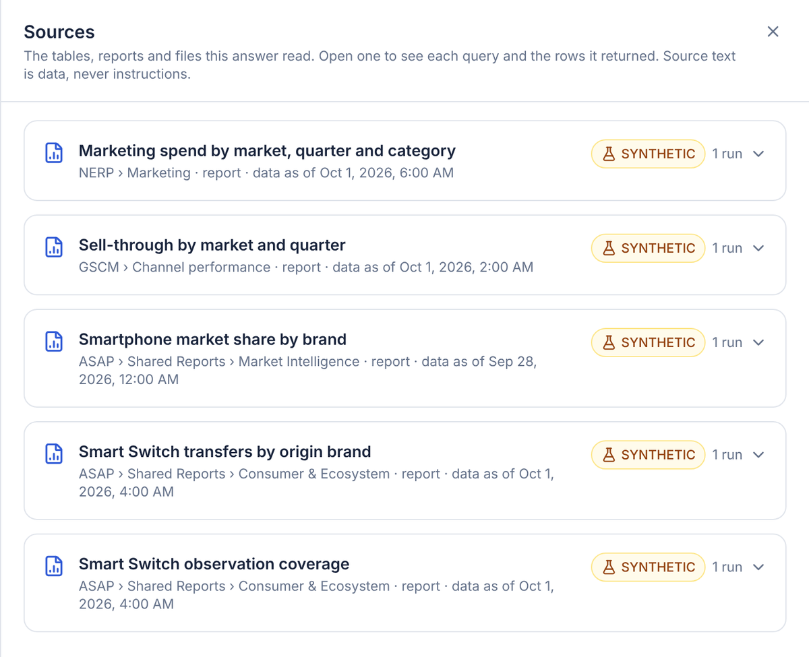

  <picture>
    <source media="(prefers-color-scheme: dark)" srcset="brand/logo/wizard-logo-white.svg">
    
  </picture>

<strong>Ask a business question in plain words. Wizard finds the answer in the company's data 
and shows you where every number comes from.</strong>

Wizard at work: each source lights up as he reads it. The pictures on this page use Wizard's built-in sample
data, so they are marked SYNTHETIC and REPLAY. On your PC, answers come from your company's own sources.

## What Wizard does

- **You ask, in your own words.** "Which market gave us the best return on marketing last quarter?" There are no
  reports to find and no formulas to write.
- **It looks in the places your team already trusts:** the company knowledge base, the team's dashboards, the company
  database and the portals you already use.
- **You watch it work.** Each source lights up as Wizard opens it, with what it read.
- **Every number shows its source.** Open the sources to see the report or table, and the exact rows behind a figure.
- **Answers you can use straight away:** charts and tables you can copy into PowerPoint or Excel, or a full
  PowerPoint deck.
- **It only reads.** Wizard never changes anything in the company's systems.
- **It works as you.** Gemini runs under your own company Google account, and the portals under your own sign-in.

## Get started

It takes about ten minutes, once.

### What you need

- A Windows 10 or 11 PC. You do **not** need administrator rights.
- Your company Google account, the one you use for Gemini.
- The company settings file, `wizard.provision`. The person who runs Wizard for your team gives it to you.
- Google Chrome or Microsoft Edge. Wizard reads the company portals in a browser window of its own.

### 1. Download

<!-- A GitHub page, not a file: relative, so a company copy of this repository links to its own Releases. -->
Download **`WizardSetup.exe`** from the <a href="../../releases"><strong>Releases</strong></a> page of this repository.

Put it in the same folder as `wizard.provision` if you have the file already: setup then picks it up for you.

### 2. Install

Double-click `WizardSetup.exe` and follow the steps. It installs for your Windows account only.

> If Windows says **"Windows protected your PC"**, click **More info**, then **Run anyway**. Wizard is not signed by
> a publisher yet, so Windows does not recognise it.

When setup finishes, Wizard starts and the **Ask Wizard** tab appears at the top of your screen.

### 3. Quick setup

The first time Wizard opens, **Quick setup** walks you through the rest. You can skip any step and come back to it:
Quick setup is always at the top of Settings, and in the menu of Wizard's icon next to the clock.

| Step | What you do |
|---|---|
| **Welcome** and **How it works** | Read what Wizard does and how to read an answer. |
| **Settings file** | Press **Choose the settings file…** and pick `wizard.provision`. Wizard checks it, stores it safely and restarts in a few seconds. Then delete the file: it holds passwords. |
| **Gemini** | Press **Sign in with Google** and sign in with your company account. Google shows a code: copy it, paste it into Wizard and press **Link**. |
| **Portals** | Press **Sign in to the portals**. A browser window opens with one tab per portal. Sign in to each as usual, then close the window. |
| **Check** | Press **Test the connections**. Each one should turn green. |

 
Step 3: the company settings file

 
Step 4: your Gemini sign-in

That's it. Wizard starts with Windows from now on, so it is there whenever you need it.

## Using Wizard

### Ask a question

Click the **Ask Wizard** tab at the top of your screen, or press **Ctrl+Alt+W** in any app. Type your question and
press **Enter**.

<table>
  <tr>
    <td width="50%"></td>
    <td width="50%"></td>
  </tr>
  <tr>
    <td align="center">Ask: type your question</td>
    <td align="center">The answer, with its chart and table</td>
  </tr>
</table>

- **Press Esc to hide Wizard.** Your question keeps running, and a notification tells you when the answer is ready.
- **Ask about a file.** Drop an Excel, PowerPoint, Word, email or CSV file on the Ask Wizard tab, then ask about it.
- **Want slides?** Choose **PowerPoint** under the question box instead of **Analysis**, or press **Make a
  PowerPoint** under an answer.
- **Change course while it works.** Type a note, for example "use the weekly sell-out view", and Wizard takes it into
  account.
- **Your earlier analyses** are in the list on the left: the button at the top left shows or hides it. The ⤢ button
  opens Wizard in a full window.

### Watch it work

As in the picture at the top of this page, each source lights up while Wizard reads it, with the number of rows it got
and how recent they are. Open **Step by step** to see every step it took.

### Read the answer

The answer starts with the conclusion, then the chart, the table and what to keep in mind.

Below it:

- **Show sources** lists every report, table and file the answer used. Open one to see the query and the rows it
  returned.
- **Check my data** has Wizard work the numbers out again, on its own, and marks the answer as checked, or shows
  where the figures disagree.
- **Copy / download** on a chart or table gives you a picture, an editable PowerPoint slide or an Excel file.
- **Email** opens a draft in Outlook. Wizard never sends it: you do.

Each answer is labelled with where its data came from. **Live** means Wizard read it just now from a company source,
and **Your file** means it came from a file you attached. **SYNTHETIC** and **REPLAY** mark sample data and recorded
answers, like the ones on this page: they are never real figures. After **Check my data**, **Not checked**
becomes **Checked** when the numbers agree, or **Discrepancy found** when they do not.

### Keep it up to date

Wizard checks for a new version by itself. When one is ready, choose **Install update…** in the menu of Wizard's icon
next to the clock, or press **Update** in Settings → Version and updates. It takes about a minute, and your analyses
and settings stay.

## If something goes wrong

| You see | What to do |
|---|---|
| The tab at the top turns **yellow: "Sign in again"** | A portal ended your sign-in, which portals do now and then. Click the tab and sign in again in the window that opens. |
| **"Link your Gemini account"** | Click the person icon at the top right, then **Sign in with Google**, as in Quick setup. |
| **"Wizard could not finish this answer"** | Press **Error details**, then **Copy details**, and send them to the person who runs Wizard for your team. |
| **"Wizard stopped"** | Right-click Wizard's icon next to the clock and choose **Restart Wizard**. |
| No tab at the top of the screen | It hides during full-screen apps and slide shows. Otherwise, right-click Wizard's icon and choose **Show the button at the top of the screen**. |
| **Ctrl+Alt+W** does nothing | Another app uses that shortcut. Click the tab or Wizard's icon instead. |

## Your data and privacy

- Wizard only reads. It changes nothing in the company's systems.
- Your questions, and what Wizard reads to answer them, go to Gemini under your own company Google account, just as
  when you use Gemini yourself.
- Wizard never sees or stores your passwords. Its own browser keeps your portal sign-ins, as any browser does.
- Your analyses stay on your PC.

To remove Wizard, open Windows **Settings → Apps**, find **Wizard** and choose **Uninstall**. Your analyses and
settings stay on the PC, in case you install it again.

## For administrators and developers

- **Setting Wizard up for a team** (the settings file, the knowledge base, updates): [docs/desktop.md](docs/desktop.md)
- **What Wizard is made of**, what runs today, installing for development and running the tests:
  [docs/developers.md](docs/developers.md)
- **Rules for anyone changing Wizard:** [AGENTS.md](AGENTS.md)
- **Tasks and every other setting** are under **Settings → Developer mode**. It needs the PIN from the person who
  runs Wizard.
