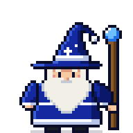
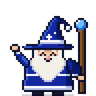
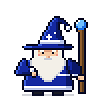
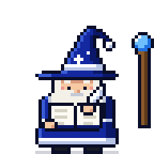
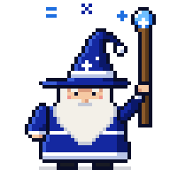
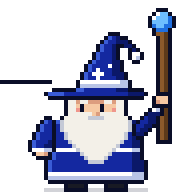
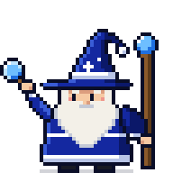
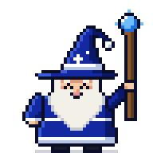

# Wizard brand: logo and character

The owner's ask (9 October 2026): Wizard is being productised and gamified. It needed a logo, a sprite, and the
wizard as a character that animates while Wizard works. He wears Samsung colours: Samsung Blue `#1428A0`, white and
black. Only the colours are used, never Samsung's logo or wordmark.

Everything here is drawn by [`scripts/wizard_art.py`](../scripts/wizard_art.py) from text grids, one character per
pixel. Do not edit the PNG or SVG files by hand: change a grid in the script, then run

```bash
python scripts/wizard_art.py           # redraw brand/ and the web app's copies
python scripts/wizard_art.py --check   # what CI runs (tests/unit/test_wizard_art.py): fails if a file is stale
python scripts/wizard_art.py --preview OUT_DIR   # big contact sheets of every frame and the logo, to look them over
```

It needs only the Python standard library, so it runs on a work PC too.

## Logo

| | File | Use |
|---|---|---|
|  | `logo/wizard-logo.svg`, `logo/wizard-logo.png` | Mark and pixel wordmark, on white or light backgrounds |
|  | `logo/wizard-logo-white.svg` | On Samsung Blue or dark backgrounds |
|  | `logo/wizard-mark.svg`, `logo/wizard-mark.png` | The mark alone: favicon, sidebar, answer cards |
|  | `logo/wizard-app-icon.svg`, `-32.png`, `-180.png`, `-512.png` | App icon: the reversed hat on a Samsung Blue tile |

- The mark is the wizard's own hat on a 16-pixel grid, so it stays sharp as a 16 or 32 pixel favicon.
- Scale pixel art by whole numbers only (2x, 3x, 4x). Never smooth it: use `image-rendering: pixelated` for PNGs.
  The SVGs carry `shape-rendering="crispEdges"`.
- Keep clear space around the logo of at least half the mark's height.

## Colours

| Role | Hex |
|---|---|
| Samsung Blue: robe, hat | `#1428A0` |
| Blue shadow | `#0B1869` |
| Blue light | `#3A5CD6` |
| White: trim, band, stars | `#FFFFFF` |
| Trim shadow | `#B8C4E6` |
| Outline (near black) | `#0A0E28` |
| Orb, sparkles (sky blue) | `#6EBEFF`, shadow `#1F6FE0` |
| A passed check | `#34C759` |

The full palette, by grid character, is in [`sprite/wizard-sprite.json`](sprite/wizard-sprite.json).

## The sprite sheet

`sprite/wizard-sprite.png`: 48 x 48 pixel frames, one row per animation, up to 8 frames per row (`wizard-sprite@4x.png`
is the same sheet at 4x). `sprite/wizard-sprite.json` gives each animation's row, frame count, frame rectangles, frames
per second and whether it loops, ready for a game engine.

| Animation | Preview | Frames · fps | When Wizard shows it |
|---|---|---|---|
| `idle` |  | 6 · 6, loops | At rest: the sign-in and loading screens |
| `wave` |  | 6 · 8, loops | Hello, on the start screen, then `idle` |
| `think` |  | 6 · 6, loops | Gemini is deciding the next step: no tool running, no text yet |
| `search` |  | 6 · 7, loops | A search tool runs: search reports, report schema, list sources, search catalog, browse knowledge |
| `read` |  | 6 · 6, loops | A read tool runs: run report, query PostgreSQL, read or query an attachment, read knowledge, look up definitions |
| `write` |  | 6 · 6, loops | Text is streaming in |
| `cast` |  | 6 · 8, loops | `wizard_calculate` runs |
| `chart` |  | 6 · 6, loops | `wizard_render_visual` runs |
| `check` |  | 6 · 6, loops | Check my data runs |
| `success` |  | 8 · 10, once | The run finished with an answer |
| `fail` |  | 6 · 7, once | The run failed |

The previews are animated PNGs at 4x. They loop, and a one-shot animation pauses on its last frame.

## In the web app

- `apps/web/src/components/WizardSprite.tsx`: `WizardSprite` plays one animation with CSS `steps()`. With reduced motion
  it holds the first frame.
- `apps/web/src/components/SystemsStage.tsx`: the wizard stands in a magic circle at the centre of a running answer,
  with the systems around him. He acts out the step in progress, and keeps acting out a fast step while its system
  stays lit. When the answer lands live he hops (`success`) with pixel confetti in the colours of the systems used, or
  fizzles (`fail`). Then the stage folds. While the view follows a long answer down, a slim bar pinned to the top keeps
  him in view. A run reopened from history has no finale.
- `apps/web/src/wizard.ts` picks the animation from the run's observed events only: the running tool, streaming text, or
  the end state. The wizard never acts out a step Wizard did not take (AGENTS.md: show what Gemini actually did).
- `apps/web/src/wizardSheet.ts` (frame size and animation table), `apps/web/src/assets/wizard-sprite.png`,
  `wizard-mark.svg`, `wizard-logo.svg` and the favicon in `apps/web/index.html` are written by the script.
- Where he appears:
  - the start screen and the desktop panel's start (he waves, then rests);
  - sign-in (logo and the wizard at rest) and the loading screen;
  - the sidebar, the panel's header, each answer card and Wizard's own module on the stage (the mark);
  - the stage on a running answer;
  - the drop target when a file is dragged over the page (he reads).

## In the desktop app (WizardBar)

- `apps/desktop/assets/wizard.ico`: the tray, taskbar, Start-menu and setup icon. It holds the hat at 16 pixels, his
  portrait (hat to beard, with the staff) at 32 and 64, and the whole wizard at 48, 96 and 256.
- `apps/desktop/assets/wizard-sprite.png` (embedded) and `apps/desktop/WizardBar/SpriteSheet.g.cs` (the animation table):
  the same sheet as the web app.
- The **Ask Wizard** button at the top of the screen draws him at 1x, or at 2x from 175 % display scaling:
  - At rest he twinkles his staff every few seconds.
  - On hover the tab drops down and he waves. A click makes him cast.
  - While a question runs he acts out what the page shows (the page sends its animation).
  - He hops when an answer is ready and fizzles when the service stopped.
  - With a file dragged over the tab he opens his book ("Drop to attach").
- `installer/wizard-large.bmp` and `wizard-small.bmp`: setup's pictures (the wizard on Samsung Blue beside the first and
  last pages, and in the corner of the others).
- `WizardBar.exe --snapshot FOLDER` draws every look of the button to PNG; the Windows CI job runs it.
- The script writes the icon, the copy of the sheet, `SpriteSheet.g.cs` and setup's pictures, and `--check` covers them.
